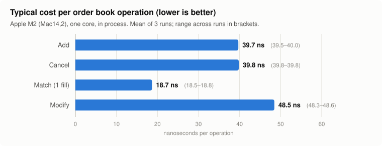
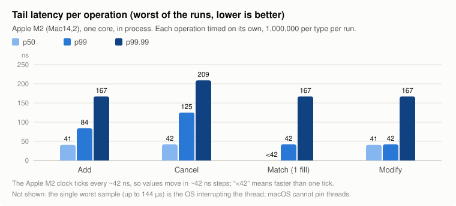

# RTES: a small stock exchange in C++, built to be correct first

[](https://github.com/shivanshu1177/Real-time-exchange-simulator/actions/workflows/ci.yml)

RTES is a working exchange simulator written in C++20. Traders connect over TCP, send orders, and get
confirmations and fills back; prices go out to everyone over UDP. I built it to learn how a real trading venue
works, and to show the engineering trading firms look for: correct order handling, simple and safe threading,
and claims backed by tests and measurements.

## At a glance

| What | Result |
|---|---|
| **Order book speed** | about **40 ns** to add or cancel an order, **19 ns** to match one, on one core of an Apple M2 |
| **Worst case (p99.99)** | at most **209 ns** for every operation, 1 million samples each |
| **Correctness** | **10 million** random orders, cancels and modifies checked against a reference order book: **0 differences** |
| **Tests** | **85** automated tests, on Linux (GCC, Clang) and macOS, including memory and thread-safety checkers |

*In plain words:* the core can process an order in a few tens of nanoseconds, it gives the same answers as a
deliberately simple reference implementation across millions of random cases, and every claim on this page
links to the code or data that backs it.

## Performance

<picture>
  <source media="(prefers-color-scheme: dark)" srcset="docs/img/bench-typical-dark.svg">
  
</picture>

<picture>
  <source media="(prefers-color-scheme: dark)" srcset="docs/img/bench-tail-dark.svg">
  
</picture>

| Operation | Typical | p50 | p99 | p99.99 |
|---|---|---|---|---|
| Add an order to the book | 39.7 ns | 41 ns | 84 ns | 167 ns |
| Cancel an order | 39.8 ns | 42 ns | 125 ns | 209 ns |
| Match (aggressive order, one fill) | 18.7 ns | < 42 ns | 42 ns | 167 ns |
| Modify (reduce quantity) | 48.5 ns | 41 ns | 42 ns | 167 ns |

**What these numbers are:**
- **Machine and setup:** an Apple M2 MacBook Air on AC power, with Apple Clang 21 and a portable `-O3` build.
- **Load:** 1,000,000 operations of each type, on a book holding 10,000 resting orders.
- **Repeatability:** 3 runs that agree within 2%.
- **"Typical"** is total time divided by operations.
- **Percentiles** time each operation on its own. The M2 clock ticks every ~42 ns, so they move in ~42 ns steps.
- **Raw data:** [`bench/results/`](bench/results/), which records the machine, compiler and git commit. The charts
  are drawn from it by [`scripts/plot_bench.py`](scripts/plot_bench.py).

**What they are not:** the order book alone, on one thread. They exclude the network, the gateway, risk checks
and the queues between threads. Full wire-to-wire latency will be measured with an open-loop load generator (so
slow responses can't hide), and published only then.

## What it does

- **Order entry over TCP:**
  - log on;
  - new, cancel and modify orders;
  - a confirmation or a reject with a specific reason for every request;
  - a fill report to both the buyer and the seller.
- **Risk checks before anything is accepted:**
  - price and size limits;
  - a price band that follows the last trade;
  - per-client exposure limits;
  - rate limits.
- **Matching:**
  - best price first, then first come, first served;
  - a client can't trade with itself;
  - market orders that don't fill right away are cancelled.
- **Market data:** best bid/offer and trades over UDP multicast.

## How an order flows

```
             TCP                         by value (queue)
  client ───────────► gateway thread ─────────────────────► matching engine (one per symbol)
    ▲                 · checks the message                  · fills in price-time order
    │                 · validates + risk checks             · owns its book and memory
    │                                                                │ fills, cancels
    └──── confirmations and fills ◄──── gateway thread ◄─────────────┘
                                                                     └─► trades, prices ─► UDP multicast
```

Threads don't share order or book data: each one owns its own, and they hand messages to each other
through queues. ThreadSanitizer finds no data races, either in the tests or in a live run with real clients.
Details: [ARCHITECTURE](docs/ARCHITECTURE.md), message formats: [API](docs/API.md).

## How I know it's correct

- **Reference check:** the real order book and a deliberately simple one get the same random activity: 100 runs
  × 100,000 operations. After every single operation, all fills, cancels and price levels must match. They do.
  When I planted bugs on purpose, this test caught each one within a few hundred operations.
  ([test](tests/test_book_differential.cpp), [reference book](tests/reference_book.hpp))
- **Order lifecycle tests:**
  - every reject reason;
  - a cancel racing a fill;
  - a cancel from the wrong client;
  - modify rules;
  - risk limits being released.

  ([tests](tests/test_order_lifecycle.cpp))
- **Network tests over real TCP:**
  - a message split at every possible byte;
  - corrupt or oversized messages;
  - disconnects.

  ([tests](tests/test_framing_sessions.cpp))
- **Checkers in CI:** AddressSanitizer, UndefinedBehaviorSanitizer and ThreadSanitizer.

## Design choices worth asking me about

- **Risk is checked on the gateway thread, before the first reply,** so a client never hears "accepted" for an
  order that is then dropped. The original version did exactly that.
- **Each matching engine owns its memory, and orders move between threads as copies.** This removed a subtle
  race in a shared lock-free pool, instead of trying to patch it. ([why](docs/design/memory.md))
- **Orders at each price sit in a linked list,** so cancelling one from the middle is a constant-time unlink.
- **No number without its context.** Every benchmark result records the hardware and commit, and says what it
  doesn't cover.

## Try it

You need CMake, Ninja and a C++20 compiler:
- **Linux:** GCC 14 or Clang 18.
- **macOS:** `xcode-select --install` and `brew install cmake ninja`.

```bash
cmake --preset release && cmake --build --preset release -j && ctest --preset release
```

```bash
./build/release/trading_exchange configs/config.json
```

In two more terminals, one buyer and one seller (different client ids, otherwise self-trade prevention stops the
trade):

```bash
./build/release/tcp_client --client-id 1 --order "BUY,AAPL,10,150.00,LIMIT" --listen-ms 5000
```

```bash
./build/release/tcp_client --client-id 2 --order "SELL,AAPL,4,150.00,LIMIT"
```

The seller gets `NEW` then `FILL`, and the buyer `NEW` then `PARTIAL_FILL` (4 filled, 6 left). To measure the
order book on your own machine:

```bash
./scripts/bench.sh && python3 scripts/plot_bench.py
```

## Not done yet

- **Measurements:** wire-to-wire latency and throughput aren't measured yet (see above).
- **Market data:** no order book depth yet, only the best price and trades.
- **Operations:** no metrics endpoint yet.
- **Security:** logon doesn't check passwords or keys.

Planned, in order, in the [roadmap](docs/ROADMAP.md):
1. an end-to-end test in CI;
2. depth;
3. record and replay;
4. fuzz testing;
5. crypto-perpetual order types;
6. a market-making research venue;
7. full benchmarks.

Open issues are listed in [KNOWN_ISSUES](docs/KNOWN_ISSUES.md).

## Repository layout

```
include/rtes/   headers: protocol, gateway, matching engine, order book, risk, memory pool, queues
src/            implementation
tests/          unit, lifecycle, network and reference-book tests
tools/          tcp_client, client_simulator, udp_receiver, bench_book
scripts/        bench.sh (run and record a benchmark), plot_bench.py (draw the charts)
bench/results/  benchmark results, one file per run
docs/           architecture, protocol, runbook, roadmap, known issues
```

MIT licensed, see [LICENSE](LICENSE).
